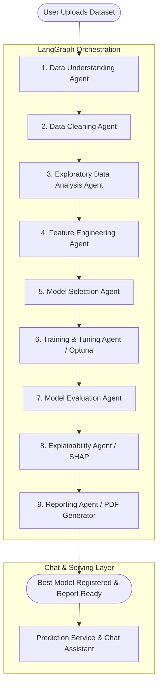

# 🤖 AI Autonomous Data Scientist Agent

[](https://fastapi.tiangolo.com)
[](https://github.com/langchain-ai/langgraph)
[](https://angular.dev)
[](https://www.microsoft.com/en-us/sql-server)
[](https://optuna.org)
[](https://shap.readthedocs.io)
[](#)

> **An enterprise-grade, fully autonomous AI Data Science multi-agent system.**  
> It automates the entire end-to-end data science lifecycle: from raw dataset ingestion and exploratory data analysis (EDA), to automated data cleaning, intelligent feature engineering, hyperparameter-optimized machine learning modeling, SHAP explainability, automated PDF/Markdown reporting, model serving, and interactive conversational analysis.

---

## 📑 Table of Contents

- [Overview](#-overview)
- [Key Features](#-key-features)
- [Multi-Agent Architecture](#-multi-agent-architecture)
- [The 10 Autonomous Agents](#-the-10-autonomous-agents)
- [Technology Stack](#-technology-stack)
- [Directory Structure](#-directory-structure)
- [API Reference](#-api-reference)
- [How to Run](#-how-to-run)
- [Workflow at a Glance](#-workflow-at-a-glance)
- [License](#-license)

---

## 🌟 Overview

Traditional data science requires days or weeks of manual work: writing data cleaning pipelines, engineering features, trying multiple ML models, tuning hyperparameters, generating plots, interpreting model weights, and assembling executive presentations.

The **AI Autonomous Data Scientist Agent** transforms this workflow into an automated, interactive experience powered by **LangGraph**, **FastAPI**, **Angular 17**, and state-of-the-art LLMs via **OpenRouter** (GPT-4o / GPT-4o-mini).

### Why this project stands out:
1. **Fully Autonomous Pipeline**: Upload your raw CSV/Excel file, click **Run Experiment**, and watch 10 specialized agents take turns analyzing, preprocessing, training, and validating models.
2. **Deterministic & LLM Hybrid**: Combines rigorous statistical tests (scipy, scikit-learn, Optuna) with LLM-guided strategic decision making.
3. **Enterprise Storage**: Backed by **Microsoft SQL Server** (or PostgreSQL) for complete persistence of experiment runs, metrics, preprocessing logs, and user credentials.
4. **Interactive Chat Assistant**: Chat directly with an AI Data Scientist about your dataset, ask for statistical insights, or request custom actions.
5. **Real-time Explainability**: Native integration with **SHAP** (SHapley Additive exPlanations) for global and local feature importance.
6. **Executive & Technical Reporting**: Automatically compiles detailed Markdown and downloadable PDF reports with charts, confusion matrices, and key takeaways.

---

## 🚀 Key Features

| Module | Features & Capabilities |
| :--- | :--- |
| **📊 Dataset Management** | Multi-format upload (`.csv`, `.xlsx`, `.parquet`), automatic schema detection, column typing, statistical profiling, missing value ratios, and cardinality tracking. |
| **🧠 Autonomous AutoML** | Dynamic problem detection (Binary Classification, Multiclass Classification, Regression), automated algorithm selection, cross-validation, and Optuna hyperparameter optimization. |
| **🧹 Intelligent Preprocessing** | Missing value imputation (mean/median/mode/iterative), outlier detection, duplicate removal, categorical encoding (One-Hot / Target / Ordinal), and feature scaling (Standard / Robust / MinMax). |
| **🔍 Explainability (XAI)** | SHAP summary plots, waterfall charts, feature importance rankings, and plain-English interpretations generated by the LLM. |
| **🎯 Prediction Sandbox** | Real-time single-row manual input prediction and batch CSV inference with downloadable predictions. |
| **💬 AI Data Scientist Chat** | Context-aware chat system linked to each experiment; ask questions like *"Why did you choose XGBoost over Random Forest?"* or *"What are the top 3 drivers of churn?"*. |
| **📄 Automated Reports** | Instantly generates professional PDF and Markdown reports with executive summaries, technical methodology, metrics tables, and recommendations. |
| **🔐 Enterprise Security** | JWT-based authentication, bcrypt password hashing, role-ready design, and CORS security. |

---

## 🏗 Multi-Agent Architecture

The core of the system is built with **LangGraph**, where a **Supervisor Agent** coordinates a graph of specialized agent nodes sharing a global `DataScienceState`.



---

## 🤖 The 10 Autonomous Agents

Each agent in the pipeline operates as a distinct specialist with its own tools, prompts, and deterministic execution logic:

```
┌─────────────────────────────────────────────────────────────────────────┐
│                      SUPERVISOR / ORCHESTRATOR                          │
│        (Manages State Transitions, Error Recovery, DB Artifacts)         │
└──────┬───────────────────────────────────────────────────────────┬──────┘
       │                                                           │
       ▼                                                           ▼
┌───────────────────────────┐                       ┌───────────────────────────┐
│ 1. Data Understanding     │                       │ 6. Model Training         │
│ • Schema & types profiling│                       │ • Optuna Hyperopt trials  │
│ • Missing value ratios    │                       │ • Stratified K-Fold CV    │
│ • Task type inference     │                       │ • MLflow metric logging   │
└──────────────┬────────────┘                       └──────────────┬────────────┘
               │                                                   │
               ▼                                                   ▼
┌───────────────────────────┐                       ┌───────────────────────────┐
│ 2. Data Cleaning          │                       │ 7. Model Evaluation       │
│ • Intelligent imputation  │                       │ • Accuracy, F1, ROC-AUC   │
│ • Outlier clipping/removal│                       │ • RMSE, MAE, R² score     │
│ • Deduplication & casts   │                       │ • Confusion Matrix / ROC  │
└──────────────┬────────────┘                       └──────────────┬────────────┘
               │                                                   │
               ▼                                                   ▼
┌───────────────────────────┐                       ┌───────────────────────────┐
│ 3. Exploratory Data (EDA) │                       │ 8. Explainability (SHAP)  │
│ • Distribution analysis   │                       │ • SHAP Tree/Kernel Values │
│ • Correlation matrices    │                       │ • Feature importance rank │
│ • Statistical anomalies   │                       │ • Natural language summary│
└──────────────┬────────────┘                       └──────────────┬────────────┘
               │                                                   │
               ▼                                                   ▼
┌───────────────────────────┐                       ┌───────────────────────────┐
│ 4. Feature Engineering    │                       │ 9. Automated Reporting    │
│ • High cardinality checks │                       │ • Executive summary       │
│ • Numerical scaling       │                       │ • Technical report (MD)   │
│ • Feature interaction     │                       │ • ReportLab PDF builder   │
└──────────────┬────────────┘                       └──────────────┬────────────┘
               │                                                   │
               ▼                                                   ▼
┌───────────────────────────┐                       ┌───────────────────────────┐
│ 5. Model Selection        │                       │ 10. AI Chat Assistant     │
│ • Problem complexity check│                       │ • Contextual experiment Q&A│
│ • Selects 3-4 candidates  │                       │ • Ad-hoc analysis queries │
│ • (XGBoost, LGBM, RF, etc)│                       │ • Plain-English advice    │
└───────────────────────────┘                       └───────────────────────────┘
```

1. **Supervisor Agent (`supervisor.py`)**: Directs the LangGraph state machine, captures agent progress, logs step timings, and persists artifacts in SQL Server.
2. **Data Understanding Agent (`data_understanding.py`)**: Analyzes columns, data types, statistical distributions, cardinality, and detects target label suitability.
3. **Data Cleaning Agent (`cleaning.py`)**: Removes corrupted rows, handles duplicate records, and applies statistical imputation strategies.
4. **EDA Agent (`eda.py`)**: Computes skewness, variance, correlation coefficients, and synthesizes key exploratory findings.
5. **Feature Engineering Agent (`feature_engineering.py`)**: Performs categorical encoding (One-Hot, Ordinal), numerical scaling (`StandardScaler`, `RobustScaler`), and feature transformations.
6. **Model Selection Agent (`model_selection.py`)**: Dynamically decides on top candidate models (XGBoost, LightGBM, Random Forest, Logistic Regression, Ridge, Lasso) based on dataset size and distribution.
7. **Training & Hyperparameter Tuning Agent (`training.py`)**: Uses **Optuna** to run Bayesian hyperparameter optimization over multiple trials with K-Fold cross validation.
8. **Evaluation Agent (`evaluation.py`)**: Compares validation metrics, plots confusion matrices / ROC curves, and selects the champion model.
9. **Explainability Agent (`explainability.py`)**: Runs SHAP explainer to calculate exact Shapley values and produces feature importance rankings.
10. **Reporting Agent (`reporting.py`)**: Compiles a publication-ready Markdown and downloadable PDF report complete with findings, methodology, and recommendations.

---

## 💻 Technology Stack

### Backend
- **Framework**: FastAPI (Async Python 3.10+)
- **Agent Orchestration**: LangGraph, LangChain Core, LangChain OpenAI
- **LLM Engine**: OpenRouter API (`openai/gpt-4o-mini`, `google/gemini-pro`, etc.) with deterministic fallback mode
- **Machine Learning**: Scikit-Learn, LightGBM, XGBoost, Optuna, Scipy, NumPy, Pandas
- **Explainability**: SHAP (SHapley Additive exPlanations)
- **Tracking & Storage**: MLflow, ReportLab (PDF Generation)
- **Database**: Microsoft SQL Server (via `aioodbc` & `pyodbc` with SQLAlchemy 2.0 async engine)

### Frontend
- **Framework**: Angular 17 (Standalone Components architecture)
- **Styling**: Tailwind CSS, Modern Dark/Light Theme
- **Data Visualization**: Apache ECharts (`ngx-echarts`), SVG charts
- **Reactive State**: RxJS 7.8, Angular Signals

---

## 📁 Directory Structure

```plaintext
AI Autonomous Data Scientist Agent/
├── .env.example                     # Example environment variables template
├── run_backend.bat                  # One-click Windows launcher for Backend
├── run_frontend.bat                 # One-click Windows launcher for Frontend
├── start_all.bat                    # One-click Windows launcher for Both Services
├── README.md                        # Project documentation (this file)
├── HOW_TO_RUN.md                    # Step-by-step setup & execution guide
│
├── backend/                         # FastAPI Backend
│   ├── .env                         # Active backend environment configurations
│   ├── requirements.txt             # Python dependencies
│   ├── init_db.py                   # SQL Server table creation script
│   ├── uploads/                     # Uploaded user datasets (.csv, .xlsx)
│   ├── reports/                     # Generated PDF reports and charts
│   ├── mlruns/                      # MLflow experiment runs and artifacts
│   └── app/
│       ├── main.py                  # FastAPI application entrypoint & middleware
│       ├── config/                  # Settings and Pydantic configurations
│       ├── database/                # SQLAlchemy async/sync connection setup
│       ├── models/                  # DB Schemas: User, Dataset, Experiment, Model, Metric
│       ├── schemas/                 # Pydantic request & response models
│       ├── api/                     # REST API endpoints (Auth, Datasets, Experiments, etc.)
│       ├── agents/                  # 10 LangGraph Autonomous Agent implementations
│       ├── services/                # Business logic services (Auth, Chat, Experiment, etc.)
│       ├── ml/                      # Machine learning training & evaluation pipelines
│       ├── tools/                   # Tool functions used by agents
│       └── utils/                   # File helpers, logging, security utilities
│
└── frontend/                        # Angular 17 Frontend
    ├── package.json                 # Node dependencies and scripts
    ├── angular.json                 # Angular workspace configuration
    ├── tailwind.config.js           # Tailwind CSS styling configuration
    └── src/
        ├── index.html               # Main HTML wrapper
        ├── styles.css               # Global Tailwind & utility styles
        └── app/
            ├── app.routes.ts        # Frontend routing definitions
            ├── auth/                # Login & Registration pages
            ├── dashboard/           # Main stats & overview dashboard
            ├── datasets/            # Dataset upload, preview & management
            ├── experiments/         # Experiment runner, live agent logs, progress
            ├── models/              # Registered models catalog & details
            ├── predictions/         # Single inference & Batch CSV prediction sandbox
            ├── explainability/      # SHAP charts & feature importance inspection
            ├── reports/             # Generated PDF / Markdown reports viewer
            ├── chat/                # Interactive AI Data Scientist chat interface
            ├── layout/              # Sidebar, navigation & footer components
            └── core/                # Auth guards, HTTP interceptors, API services
```

---

## 🔌 API Reference

When the backend is running, complete interactive documentation is available at `http://localhost:8000/docs`.

### Primary Endpoints:

| Method | Endpoint | Description |
| :--- | :--- | :--- |
| `POST` | `/api/auth/register` | Register a new user account |
| `POST` | `/api/auth/login` | Authenticate user and receive JWT access token |
| `GET` | `/api/auth/me` | Fetch currently authenticated user profile |
| `POST` | `/api/datasets/upload` | Upload new dataset (`.csv`, `.xlsx`, `.parquet`) |
| `GET` | `/api/datasets` | List all uploaded datasets |
| `GET` | `/api/datasets/{id}` | Inspect dataset schema, preview rows, and stats |
| `POST` | `/api/experiments` | Create and launch a new autonomous experiment |
| `GET` | `/api/experiments` | List user experiments with status |
| `GET` | `/api/experiments/{id}` | Fetch experiment details, live agent steps, metrics |
| `GET` | `/api/models` | List all trained models from all experiments |
| `GET` | `/api/models/{id}` | View detailed hyperparameters, metrics, and SHAP artifacts |
| `POST` | `/api/predictions/{id}/single` | Run inference on a single JSON input record |
| `POST` | `/api/predictions/{id}/batch` | Run inference on an uploaded batch CSV file |
| `GET` | `/api/reports/{id}/pdf` | Download the generated PDF report |
| `POST` | `/api/chat/{experiment_id}` | Send query/instruction to the AI Data Scientist agent |
| `GET` | `/health` | Server and database health check |

---

## 🏃 How to Run

For complete, detailed instructions on setting up Microsoft SQL Server, Python, Node.js, and running the application, please refer to:

👉 **[HOW_TO_RUN.md](HOW_TO_RUN.md)**

### Quick Start (Windows):
Simply double-click the included batch launcher:
```bat
start_all.bat
```
This automatically launches:
1. **FastAPI Backend** on `http://localhost:8000`
2. **Angular 17 UI** on `http://localhost:4200`

---

## 💡 Workflow at a Glance

1. **Sign in** to the dashboard at `http://localhost:4200`.
2. Navigate to **Datasets** and upload your tabular data (e.g. `customer_churn.csv`).
3. Click **New Experiment**, select the dataset, specify the target column, and click **Start Pipeline**.
4. Observe the **10 Autonomous Agents** collaborating in real-time.
5. Review the **Leaderboard of Trained Models**, inspect **Confusion Matrices** and **SHAP Feature Importance**.
6. Download the **Executive PDF Report** or ask questions in the **AI Chat** interface.
7. Switch to the **Predictions Sandbox** to test predictions on fresh data.

---

## 📄 License

This software is developed for advanced Autonomous AI Machine Learning and Data Science research. All rights reserved.
